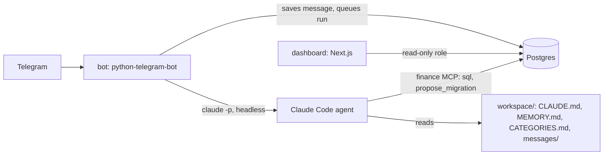

# Personal finance tracker

A personal finance tracker you mostly talk to. Send a Telegram bot a sentence ("auto 120", "dinner 1800, split with flatmate"), a screenshot of a payment or a quick-commerce order, or a bank statement file. A Claude Code agent turns that into double-entry ledger entries in Postgres. A local dashboard shows where the money went.

It runs entirely on your laptop as a Docker Compose stack. Claude Code uses your Claude subscription, and no other service sees your data.

## What v1 does

- **Chat capture.** Free-form text, screenshots (UPI, Swiggy, Blinkit, Zepto …) and statement files (PDF, CSV, XLSX, DOCX, Numbers) in Telegram. Quick-commerce orders are split per item into categories.
- **Statement imports.** Files are pre-parsed (qpdf for password-protected PDFs, [LiteParse](https://github.com/run-llama/liteparse) for PDFs and Office files), staged, de-duplicated against what's already recorded, and summarised. Nothing is committed until you press ✅ Commit in Telegram.
- **A real ledger.** Every transaction is double-entry: its postings sum to zero, and the database enforces that. This handles messy flows correctly: self-transfers between your own accounts, credit card bills paid via CRED, rent passed through from a flatmate, money held by family, and loans repaid in EMIs. Only real spending counts as spending.
- **Hierarchical categories** defined in `workspace/CATEGORIES.md`, plus cross-cutting lenses for trips, people (for example a partner) and local transport.
- **Splitwise queue.** Splitwise's API is paid, so shared expenses are staged with the split already worked out ("my share is X, rest to Splitwise"). You copy each one into Splitwise and mark it added, from the dashboard or with `/splitwise` in Telegram.
- **Edit and undo** any agent change from Telegram, by run.
- **Agent-proposed schema changes.** The agent can propose a migration. It is dry-run under a restricted role and applied only after you press Apply in Telegram.
- **Dashboard** (Next.js, read-only): month overview with spend against last month, categories, lenses, balances and dues, bills and transfers, a transactions browser, and the Splitwise queue.
- **Local observability.** Every message is saved in its own folder. Every agent run is logged as JSONL and recorded in the `agent_runs` and `tool_calls` tables. Every ledger change is audited, tagged with the run that made it.

## How it fits together



- **`bot/`, `ft_bot/`:** the Telegram bot. It accepts only your chat ID, saves every message as soon as it arrives, and runs one agent at a time from a Postgres-backed queue. It also handles the approval buttons.
- **`ft_mcp/`:** the MCP server the agent uses: a `sql` tool and a migration proposal tool.
- **`ft_db/`, `db/`:** the schema (`db/migrations/001_init.sql`), seed data, category sync, tests and backups.
- **`workspace/`:** the agent's working directory: its instructions (`CLAUDE.md`), long-term memory (`MEMORY.md`), the category tree, the generated `SCHEMA.md`, and the saved messages.
- **`dashboard/`:** the Next.js dashboard.

**Guardrails.**
- The agent has no shell. It can only edit `MEMORY.md` and `CATEGORIES.md`, and it talks to Postgres as a role that can change rows but not the schema.
- Schema changes go through a separate migrator role, and only after you approve them.
- The dashboard connects as a read-only role.
- Text inside uploaded files is treated as data, never as instructions.

## Setup

You need Docker, [uv](https://docs.astral.sh/uv/), a Telegram bot token from [@BotFather](https://t.me/BotFather), and a Claude subscription.

```bash
cp .env.example .env                                # then fill it in (below)
cp workspace/MEMORY.example.md workspace/MEMORY.md  # your private facts for the agent

make db-up             # start Postgres (127.0.0.1:5433)
make migrate           # apply the schema, set role passwords
make seed              # base accounts
make sync-categories   # load workspace/CATEGORIES.md
make up                # build and start postgres, bot and dashboard
```

In `.env`:
- `TELEGRAM_BOT_TOKEN`
- `TELEGRAM_ALLOWED_CHAT_ID`: send your bot a message, then read it from `https://api.telegram.org/bot<token>/getUpdates`
- `CLAUDE_CODE_OAUTH_TOKEN`: from `claude setup-token`
- the database passwords
- optionally `STATEMENT_PASSWORDS` for encrypted PDFs

Open the dashboard at http://localhost:4100. Change the port with `DASHBOARD_PORT` in `.env`.

## Everyday commands

| Command | What it does |
| --- | --- |
| `make up` / `make down` | Start or stop the whole stack. Your data stays in the `pgdata` volume. |
| `make restart`, `make ps`, `make logs S=bot` | Restart, show status, follow logs |
| `make backup` | `pg_dump` into `backups/` |
| `make test-db` | Ledger and role checks against a throwaway database |
| `uv run pytest` | Bot and MCP tests |

In Telegram: `/new` starts a fresh agent session (sessions also roll over daily), `/status` shows the queue and the last run, and `/splitwise` lists pending Splitwise entries.

## Privacy

Your data stays on your machine: `.env`, `workspace/MEMORY.md`, `workspace/messages/`, `logs/` and `backups/` are all gitignored. Keep bank statements in a folder that is gitignored and in `.dockerignore`.

## More detail

- [docs/database.md](docs/database.md): roles, migrations, the MCP server, backups
- [bot/README.md](bot/README.md): how the bot runs Claude, sessions and approvals
- `PRODUCT.md`, `DESIGN.md`: the dashboard's product and design notes
